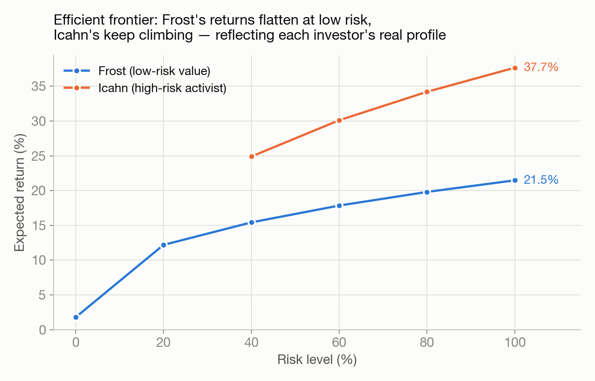

# Non-Linear Portfolio Optimization: Frost vs. Icahn

A non-linear optimization project that rebuilds the public equity portfolios of two well-known investors with opposite risk styles, then solves for risk-return-optimal allocations along the efficient frontier.

Team project for the **Business Analytics (Non-Linear Optimization)** course at Hult International Business School.

---

## The problem

Two investors, two philosophies: **Philip Frost** (low-risk value / biotech) and **Carl Icahn** (high-risk activist). The project pulled each one's publicly disclosed holdings and asked: given their actual positions, what does a risk-return-optimal portfolio look like, and how does it differ by style?

## The approach

- **Data:** 10 stocks per investor pulled programmatically (yfinance / yahooquery) over 2024, with shares held and portfolio weights reconstructed via a backtracking method from portfolio percentage and close price.
- **EDA:** univariate, bivariate, and multivariate analysis of price, volume, shares held, and dividends.
- **Hypothesis test:** whether adjusted close price relates to shares held, trading volume, and dividends.
- **Optimization:** objective function, decision variables, and constraints defined for a non-linear risk-return problem; the **efficient frontier** computed for each portfolio, plus sensitivity analysis.

## Results

- **Shares held are strongly negatively correlated with adjusted close price** across all stocks (−0.976 to −0.997).
- **Trading volume** showed mixed effects by stock; **dividends had no significant impact** on adjusted close.
- The efficient frontiers matched each investor's profile — Frost's risk rose steeply at low return then flattened, consistent with a lower-risk posture.

## Deliverables

- [`portfolio_optimization_analysis.ipynb`](portfolio_optimization_analysis.ipynb) — the full Python analysis and optimization.
- [`portfolio_optimization_report.pdf`](portfolio_optimization_report.pdf) — the summary deck.

## Stack

- Python — yfinance, yahooquery, pandas, matplotlib (EDA, optimization, efficient frontier)
